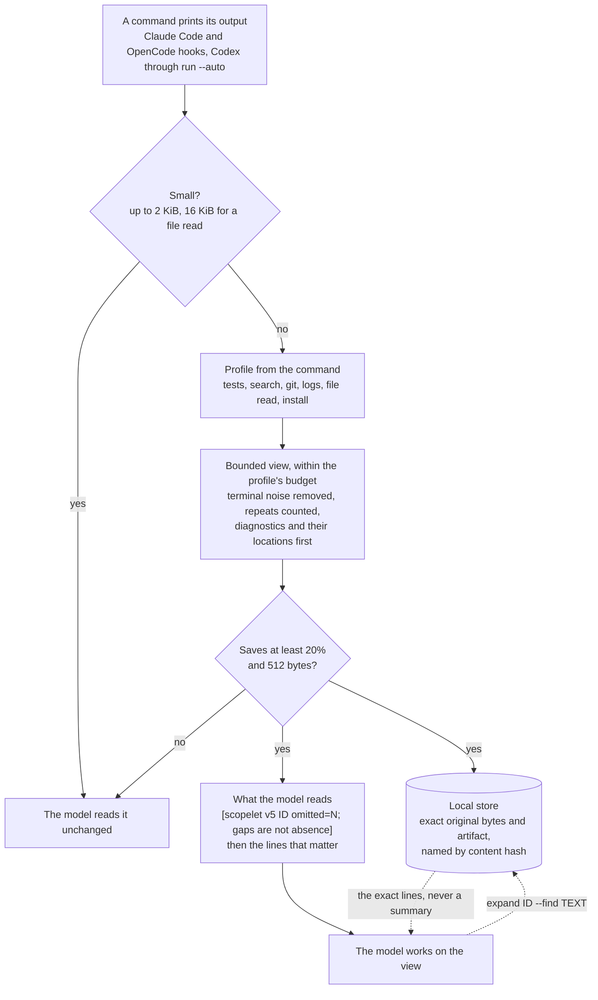

<p align="center">
  <strong>Scopelet</strong><br>
  Your agent reads a 17 KB test log to learn one thing. Send it the one thing.
</p>

<p align="center">
  <a href="https://github.com/maxgfr/scopelet/releases"></a>
  <a href="#license"></a>
  <a href="#install"></a>
  <a href="#the-numbers"></a>
  <a href="https://skills.sh/maxgfr/scopelet"></a>
</p>

<p align="center">
  <a href="#see-it">See it</a> ·
  <a href="#why-you-want-this">Why</a> ·
  <a href="#how-it-works">How</a> ·
  <a href="#install">Install</a> ·
  <a href="#the-numbers">Numbers</a> ·
  <a href="#nothing-is-lost">Recovery</a> ·
  <a href="#exact-queries">Queries</a> ·
  <a href="#what-gets-compressed">Scope</a> ·
  <a href="docs/design.md">Contracts</a>
</p>

---

## See it

Your test suite prints 481 results. One of them matters.

<table>
<tr>
<th width="50%">Without Scopelet · 17,549 bytes</th>
<th width="50%">With Scopelet · 542 bytes</th>
</tr>
<tr>
<td valign="top">

```
> app@1.4.2 test
> jest --runInBand

PASS  src/modules/module0.test.js
PASS  src/modules/module1.test.js
PASS  src/modules/module2.test.js
        ... 237 more PASS lines ...
FAIL  src/auth/session.test.js
  ● session › refreshes an expiring token

    expect(received).toBe(expected)

    Expected: 1735689600
    Received: 1735689599

      at Object.<anonymous> (src/auth/session.test.js:42:31)
PASS  src/modules/module240.test.js
        ... 239 more PASS lines ...

Test Suites: 1 failed, 480 passed, 481 total
Tests:       1 failed, 1327 passed, 1328 total
Time:        84.113 s
```

</td>
<td valign="top">

```
[scopelet v5 47487d02d1c0 omitted=0 abridged=1;
 gaps are not absence]
1-3
 > app@1.4.2 test
 > jest --runInBand

4 similar=480 last=492 PASS  src/modules/module0.test.js
244-252
 FAIL  src/auth/session.test.js
   ● session › refreshes an expiring token

     expect(received).toBe(expected)

     Expected: 1735689600
     Received: 1735689599

       at Object.<anonymous> (src/auth/session.test.js:42:31)
493-496

 Test Suites: 1 failed, 480 passed, 481 total
 Tests:       1 failed, 1327 passed, 1328 total
 Time:        84.113 s
```

</td>
</tr>
</table>

The failure kept its expected value, its received value and its stack frame.
The 480 passes became one line that still says there were 480 and where the
last one was. The header says what that cost: `omitted=0` means every line of
the log is shown or folded into a counted group, and `abridged=1` that one
group stands for lines that differ (here, by their numbers). A view with
nothing left out says `complete` instead.

This happens automatically, on the machine, with no second model call, no API
key and no proxy. The original 17,549 bytes are still on disk under the ID in
the header, and the session guidance tells the agent how to get any of them
back.

## Why you want this

Agents read far more than they write. Test output, build logs, `git diff`,
JSON dumps: all of it enters the context window verbatim, and most of it is
the same line five hundred times. That is the part of the bill nobody looks
at, and it is also what pushes a session into compaction and makes the agent
forget what it was doing.

Scopelet sits on the hook your agent already has. When a command prints
something large, it replaces the output with a bounded view before the model
sees it, keeps the exact original bytes in a local content-addressed store,
and names them in the first line; the recovery command comes once, with the
session guidance. The agent can always ask for the rest. It usually does not
need to.

What it is not: it does not call another model to summarize, it does not
intercept API traffic, it does not rewrite your conversation history, and it
does not touch small outputs at all.

## How it works



Nothing leaves the machine and no other model is called. The view is the only
thing that changes: the original is kept byte for byte, every gap is counted
in the header, and the session guidance tells the agent how to read any of it
back. In Claude Code, an output the conversation has already seen becomes a
one-line reference to it.

## Install

Requires **Node.js 22.20+** for the `skills` installer. The bundled launcher
itself supports Node 18+. Release binaries cover macOS Intel/ARM and Linux
Intel/ARM with Ubuntu 24.04-compatible glibc. Native Windows is not supported.

```sh
npx skills add maxgfr/scopelet --skill scopelet --global -a codex claude-code opencode -y
node "$HOME/.agents/skills/scopelet/scripts/scopelet.mjs" install --agent all
node "$HOME/.agents/skills/scopelet/scripts/scopelet.mjs" doctor
```

The first command installs the skill. The second downloads its pinned release,
checks SHA-256, and installs the automatic hooks for Claude Code, Codex and
OpenCode with **default mode enabled**. The third reports the installed binary
and `hooks_configured` for all three hosts. The skill installer does **not**
put a `scopelet` command on your PATH.

Restart active agent sessions. In Codex, review and trust the new hooks through
`/hooks` when prompted; `doctor` checks configuration, not interactive trust.
OpenCode 2 picks its plugin up at startup with no trust step. After activation,
ordinary prompts use the hooks without `/scopelet` or `$scopelet`. Use
`--agent claude`, `--agent codex` or `--agent opencode` to enable one host.

### Homebrew

The same macOS and Linux binary ships in a tap. This is the one install that
puts a `scopelet` command on your PATH, and it needs no Node at all: the binary
installs its own hooks.

```sh
brew install maxgfr/tap/scopelet
scopelet install --agent all
scopelet doctor
```

`install` copies the binary to `~/.config/scopelet/bin/scopelet` and points the
hooks at that copy, so re-run it after `brew upgrade scopelet`. The formula
carries the binary only: add the skill with the `npx skills add` line above if
you also want `/scopelet` and `$scopelet`.

### Automatic or manual

Scopelet is **automatic by default**: the hooks compress on every large output,
with no invocation and no decision from the model. Manual is always available,
and both switches are yours.

- **Skip the hooks entirely.** Run only the first command and invoke
  `/scopelet <task>` in Claude Code or OpenCode, `$scopelet <task>` in Codex.
  Rust is not required for this setup.
- **Stop automatic compression later.** `mode off` keeps the hooks installed and
  idle; `uninstall --agent all` removes them and leaves the skill.
- **Hide the skill from the model.** The shipped skill is model-invocable, so an
  agent can reach the queries below on its own. To make it explicit-only, add
  `disable-model-invocation: true` to `SKILL.md`, one setting read by Claude
  Code and OpenCode. Reinstalling restores the shipped default.

[Full setup and host coverage](skills/scopelet/references/setup.md).

## The numbers

### Smaller

Each row is a real command output that hides one fact an agent needs: a
failing test, a fatal error after a thousand retries, a receipt in the middle
of a log. **Printed** is what the command wrote. **Read** is what reaches the
model instead, at the default 4 KiB budget. The difference is on disk, and any
line of it is one `expand` away. A view is only useful if the fact is still in
it, so the second column says what survived.

| What the command printed | What the agent reads instead | Printed | Read | Removed |
| --- | --- | ---: | ---: | ---: |
| 480 passing tests, one failure | The failing test with its expected value, received value and stack frame; the 480 passes as one line marked `similar=480` | 17,549 | 542 | **96.9%** |
| A retry loop hiding one fatal error | `error: retry failed` once, marked `repeat=1000`, then the single fatal line with its line number | 28,039 | 163 | **99.4%** |
| 1000 progress lines, then two diagnostics | Both diagnostics word for word; the progress as one line marked `similar=1000` | 136,063 | 304 | **99.8%** |
| The same log with CRLF endings | The same view; the original `\r\n` bytes stay intact on disk | 137,031 | 266 | **99.8%** |
| A receipt buried in the middle of a log | The receipt line at line 501, amount and currency exact | 136,193 | 428 | **99.7%** |
| A 1000-row JSON array | A table of CSV rows: the first ones, the one whose status is `failed`, and the last; the two columns identical in every row named once, the 21-digit integer exact, every other row counted | 171,834 | 3,209 | **98.1%** |
| A 1000-row JSONL stream | The same table; `indices=` names each row's position in the stream | 171,832 | 3,694 | **97.9%** |
| One 12 KB line with no newline | Its first 1.1 KB behind a `text_truncated bytes=12000` marker | 12,000 | 1,094 | **90.9%** |
| A 32-byte command output | The 32 bytes exactly as printed | 32 | 32 | untouched |

Small outputs are the last row on purpose. Under 2 KiB nothing happens at all,
and above it a view is only substituted when it saves at least 512 bytes and
20% including its own metadata. Scopelet declining to act is a normal outcome.
Every figure is measured by `scripts/check_readme.py` on the shipped binary,
and the fixtures are pinned by SHA-256 in `tests/content_gate.rs`.
[Benchmark reproduction](bench/README.md) ·
[what is verified](docs/verification.md).

### Faster

<!-- speed-table:start -->
Median over 30 runs, cold application cache, macOS arm64, Scopelet
1.1.2, measured by `bench/publish.py` on the binary that shipped.

| Operation | Median |
| --- | ---: |
| Compress a 136 KB log | **7 ms** |
| Compress a 3 MB log | **26 ms** |
| Repository query over 400 files | **11 ms** |
| Compress a 32 MiB stream | **68 ms** |
<!-- speed-table:end -->

These figures are replaced on every release: `bench/publish.py` measures the
new binary, writes the content and performance reports under
`bench/results/` and rewrites this table. The live, token and next-action
reports beside them name the binary they measured by its SHA-256 and stay
until a new campaign replaces them.

Every stored item is a synced temporary renamed into place, and every read is
checked against its content hash, so an interrupted write yields a missing or
rejected item, never a wrong one. Sending the same output twice reuses the
stored original by address instead of reading and re-hashing it.

> [!IMPORTANT]
> **Bytes are not tokens, and none of the numbers above is a bill.** The
> latest live campaign (`bench/live.py`, Claude Code 2.1.301, sixteen synthetic
> tasks, 144 Haiku sessions in paired rounds) found every task done correctly
> with Scopelet off, with 0.11.1 and with 1.0. Per successful task, 1.0 cost
> $0.00200, 10% less than 0.11.1's $0.00223 (95% interval of the difference
> entirely below zero), mostly because a build's error now keeps its location
> in the view; Scopelet off cost $0.00223, no different from 0.11.1. A
> session's cost follows its turns (each about 19,500 input tokens, cache
> included), the model narrows most commands itself, and outputs over about
> 30 KB are saved to a file by Claude Code, which shows its own preview, so
> views reached the model on six of the sixteen tasks. The reports are in
> `bench/results/`. Whole-session cost depends on your host, model and task.
> Measure your own setup before you tell anyone a percentage.
> [What is verified](docs/verification.md) ·
> [benchmark reproduction](bench/README.md).

## Nothing is lost

Every view links the artifact that holds the original bytes. Reading them back
does not involve the model.

```sh
scopelet expand last --find 'Received:' --context 3
scopelet expand 3f9c2d1e --find 'panick(ed)? at' --regex --ignore-case
scopelet expand artifact:HASH --manifest
scopelet expand blob:HASH --start 240 --end 260
scopelet expand blob:HASH --raw > original.log
```

`last` is the latest automatic view; any unique prefix of 8 hex characters or
more names an artifact or original. A large original comes back a page of
lines at a time, with `next_start` for the next one. Artifact IDs hash the
complete dataset and blob IDs hash the original bytes, so recovery is
byte-exact or it fails loudly. `--find` searches the saved
originals, including evidence a query had already filtered out. A partial view
cannot prove absence or an exhaustive count: recover the exact bytes before
editing something you only saw a summary of.

## Exact queries

Filtering, grouping and counting a large file locally beats sending the file.

```sh
scopelet query --repo . --find validateToken --context 5
scopelet query --file events.jsonl --format jsonl \
  --filter /status --equals '"failed"' --group /suite --output compact
scopelet run --auto -- npm test
```

For a standalone `scopelet` command, install with **Rust 1.88+**:

```sh
cargo install --git https://github.com/maxgfr/scopelet --tag v1.1.2 --locked
```

Without Cargo, replace `scopelet` with
`node "$HOME/.agents/skills/scopelet/scripts/scopelet.mjs"`. Keep native tools
for small known files. Default JSON views use 16 KiB; `--mode ultra` uses 4 KiB
and may abridge text. Budgets are bytes, not token estimates.
[Query reference](skills/scopelet/references/queries.md).

Optional [codeindex](https://github.com/maxgfr/codeindex) and
[webindex](https://github.com/maxgfr/webindex) adapters add code relationships
and document extraction. Files, logs, JSON and repository queries need neither.

## What gets compressed

Codex hooks wrap recognized noninteractive commands (tests, builds, linters,
searches, Git history, logs, file reads), parsed in a small shell subset that
understands quotes, `2>&1`, `cd DIR &&`, `&&`, `|| true` and pipes into
read-only filters. A wrapped command still goes through Codex's own approval.
Claude Code hooks replace Bash output, and the text of a Grep in content mode,
when the host supplies a supported result shape; a subagent starts with the
recovery command and is asked for a final report of conclusions with
`file:line` evidence. The OpenCode plugin (OpenCode 2) replaces the `shell`
tool's output from `execute.after` under the same thresholds. Other tools (Read among them),
MCP results, unsupported shell syntax, existing output wrappers and outputs the
host has already persisted all pass through untouched.

In Claude Code, an output identical to one the same conversation was already
shown becomes a one-line reference to it, until the conversation is compacted
or cleared; a subagent keeps its own memory of what it was shown. Terms of your
prompt (identifiers, paths, quoted text, error codes) and of the command (a
search pattern, a test filter) rank the lines that contain them into the view.
They stay in a private per-session file, never in the journal.

Each recognized command gets a budget that fits what its output is for: 2 KiB
for package installs, 4 KiB for tests, 8 KiB for searches, Git and logs, 16 KiB
for file reads, which stay whole up to 16 KiB so an ordinary source file is read
as written. Small automatic outputs never open the cache store. A local
journal, never transmitted, records each decision; `scopelet stats` shows
compressions, bytes saved, why outputs passed through, repeats, which programs
were compressed without a profile, and per profile how often a view was
expanded and how, flagging a profile whose views are expanded too often
(`SCOPELET_EVENTS=0` turns it off). It names a program by its bare name only,
never its arguments.

Inside a view, Scopelet reads each line the way a terminal would, dropping
colour codes and keeping only the final state of a progress bar. Then:

| Notation | Meaning |
| --- | --- |
| `[scopelet v5 ID complete]` | the whole output is shown or folded into exact repeats |
| `[scopelet v5 ID omitted=N abridged=M; gaps are not absence]` | N units left out, M shown in part; `expand ID --find TEXT` recovers them |
| `[scopelet v5 ID repeat: identical to output already shown …]` | this conversation already saw these exact bytes |
| `failed=2: name (file:line), …` | below a test view's header: the failures to open first |
| `totals runs=17 passed=362 failed=0 ignored=3 (every test result line, …)` | below it, for cargo over several test binaries: every `test result:` summed |
| `42 text` | line 42, shown as displayed |
| `10-14 repeat=5 text` | lines 10 to 14 are all this line |
| `4 similar=480 last=492 text` | 480 lines share this shape, first at 4, last at 492 |
| `7 text_truncated bytes=12000 prefix…` | one line too big for the budget, cut on a character boundary |
| `40-44` then indented lines | lines 40 to 44 verbatim, one space of indent each |
| `40-44 file=src/a.rs more=7` then ` 12:text` | search results of one file, its path written once; 7 of its matches not shown |
| `9-95 file=Cargo.lock changed=+43/-3 omitted` | a lockfile's or generated file's diff, counted |
| `src/components/ files=402 ext=tsx:400,ts:2` | a large directory of a listing, with its first and last entries |
| `table id,status rows=31/1000 indices=0-28,643,999` then CSV rows | a table of the rows shown, their positions, and how many there are |
| `constant region=eu-west`, `omitted_columns body,user` | columns equal in every row, named once; fields left out of the rows |
| `envelope {…}` then `table=/items …` | a JSON object's other fields, then its dominant array as a table |

`ID` is 12 hex characters of the artifact, and a query's view keeps each
record's source in front of its line numbers (`src/a.rs:12 text`). Line
numbers are always absolute positions in the original. Markers are metadata:
they are never bytes claimed to appear in your output. Selection keeps the
first and last line, then the first occurrence of each distinct diagnostic
with the stack frame or `--> file:line:col` right below it, then repeats,
warnings and the lines around a failure, filling from both ends so a final
summary survives a flood of errors. Scopelet writes one format since 1.0; the
views and artifacts of earlier versions stay readable by `expand`.
[Contracts and limits](docs/design.md).

## Response style

| Mode | Behavior |
| --- | --- |
| `default` | Adaptive compression; routine edits reuse existing code and make the smallest change that passes existing checks, then 1–3 short outcome/validation sentences. Enabled on first install. |
| `caveman` | Same compression and reuse rule; routine replies target 30 words, exceeding that when needed to retain meaning or meet the request. |
| `off` | Disable automatic compression and its response preference. |

```sh
node "$HOME/.agents/skills/scopelet/scripts/scopelet.mjs" mode caveman
node "$HOME/.agents/skills/scopelet/scripts/scopelet.mjs" mode default
node "$HOME/.agents/skills/scopelet/scripts/scopelet.mjs" mode off
```

Mode changes apply at the next prompt. They change neither the model nor its
reasoning effort. Shorter wording does not guarantee a cheaper whole session,
and shortening a reply never justifies skipping verification. Saved documents
use normal prose.

## Upgrade or remove

```sh
npx skills update scopelet --global -y
node "$HOME/.agents/skills/scopelet/scripts/scopelet.mjs" install --agent all
node "$HOME/.agents/skills/scopelet/scripts/scopelet.mjs" doctor
```

Reinstalling updates the pinned hook binary and preserves unrelated hooks.
Restart current sessions and review changed hooks in Codex. Update
project-local skill copies too if you use them; they can shadow the global
installation.

Remove hooks before removing the skill:

```sh
node "$HOME/.agents/skills/scopelet/scripts/scopelet.mjs" uninstall --agent all
npx skills remove scopelet --global -a codex claude-code opencode -y
```

Uninstall preserves configuration backups and cached originals. Clean old
artifacts separately with `clean --older-days 7`, and cap the cache with
`--max-size 500M`; references expire when their snapshots are removed.
[Paths, backups and cleanup](skills/scopelet/references/setup.md).

## License

MIT · [Issues and support](https://github.com/maxgfr/scopelet/issues)
